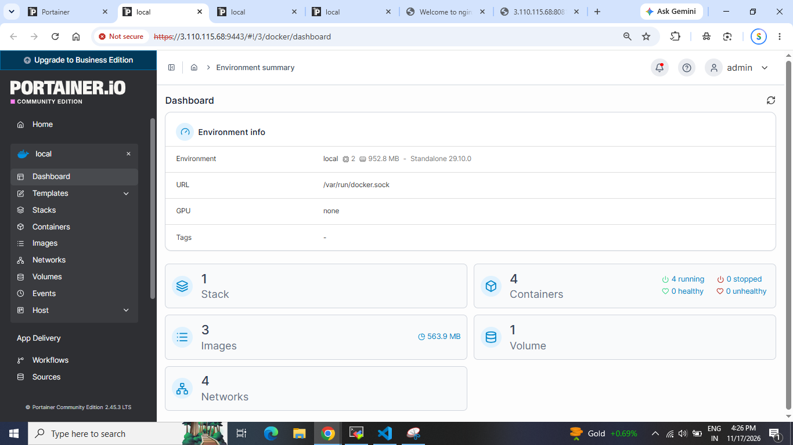
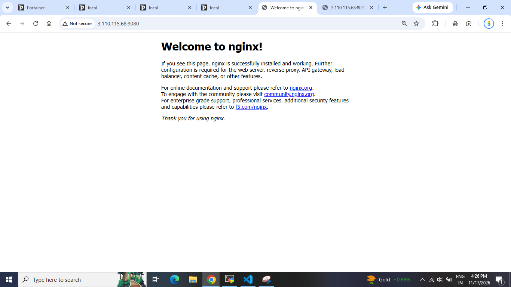
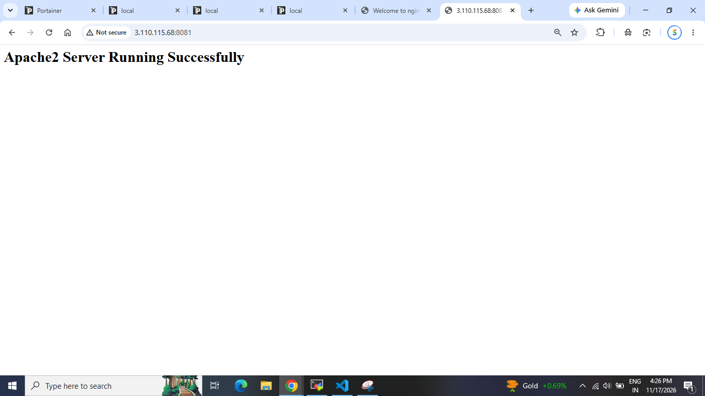
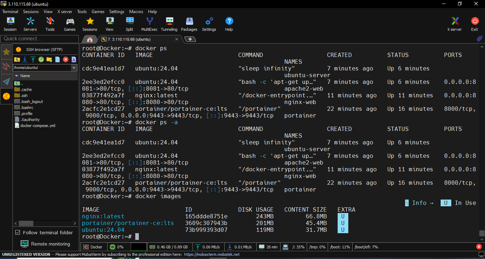

# Docker and Portainer on AWS EC2

## Project Overview

Installation and management of Docker Engine and Portainer CE
on an AWS EC2 Ubuntu server.

## Infrastructure

- Cloud: AWS
- Service: EC2
- Operating System: Ubuntu 26.04 LTS
- Docker Engine: 29.10.0
- Docker Compose: 5.7.2
- Portainer CE: 2.45.3

## Docker Containers

| Container | Service | Host Port |
|---|---|---|
| nginx-web | Nginx | 8080 |
| apache2-web | Apache2 | 8081 |
| ubuntu-server | Ubuntu | None |
| portainer | Portainer CE | 9443 |

## Project Structure

```text
portainer/
├── documentation/
├── screenshots/
├── docker-compose/
└── README.md
```

## Documentation

See the documentation folder for installation guides.

## Screenshots

### Portainer Dashboard



### Home Page


### Container Status


### Images Page


### Nginx



### Apache2



### Docker CLI



## Cleanup

Docker cleanup commands are documented in the installation guides.

## Author

AWS EC2 | Ubuntu | Docker | Portainer
